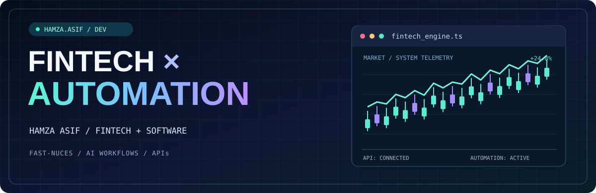
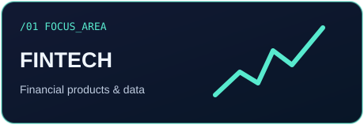
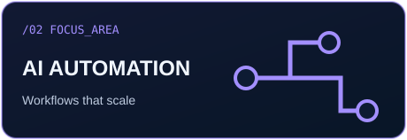
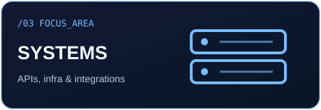

<div align="center">



<br />

### Hi, I'm Hamza Asif 👋

**FinTech Undergraduate @ FAST-NUCES · Automation & Systems Builder · Samify Solutions**

*I combine financial thinking with software engineering to build smarter systems.*

[](https://samifysolutions.com)
[](https://github.com/hamzaraw2024-source)
[](https://github.com/hamzaraw2024-source/fundedx-box-magic-8ef79a38)

</div>

---

### `01 // about.exe`

I'm **Hamza**, pursuing **BS Financial Technology at FAST-NUCES, Islamabad**. I work where **finance, automation, and engineering** intersect.

At **Samify Solutions**, I'm involved in building practical automation and integration solutions for business workflows. I'm especially interested in the technology behind **funded trading firms, financial products, and efficient operations**.

> **My approach:** Think like a FinTech problem-solver. Build like an engineer. Improve like a product owner.

### `02 // focus_areas`

<div align="center">
  
  
  
</div>

| Discipline | What excites me |
|:--|:--|
| 💳 **FinTech** | Financial systems, trading workflows, risk, and data-driven products |
| ⚡ **Automation** | n8n pipelines, integrations, webhooks, and process orchestration |
| 🧠 **Applied AI** | Connecting AI capabilities to practical business problems |
| 🛠️ **Software Engineering** | Web apps, APIs, databases, reliability, and clear user experiences |

### `03 // featured_build`

<table>
<tr><td>

#### 🎁 [FundedX Mystery Box](https://github.com/hamzaraw2024-source/fundedx-box-magic-8ef79a38)

A **trader-focused, invitation-only reward reveal interface** that demonstrates how a promotional experience can be designed as a modern web application.

**Technology in the public repository:** `TypeScript` · `React` · `TanStack Start` · `Tailwind CSS`

**[Explore the code →](https://github.com/hamzaraw2024-source/fundedx-box-magic-8ef79a38)**

</td></tr>
</table>

*Some professional automation projects are private or client-facing. I share public examples where appropriate, without exposing proprietary systems or confidential data.*

### `04 // engineering_toolkit`

**Web & application development**


**Automation & engineering foundations**


### `05 // now_learning`

```yaml
hamza:
  degree: "BS FinTech @ FAST-NUCES"
  focus: "Financial technology + automation"
  currently_exploring:
    - "Financial data analysis and risk"
    - "Software for trading operations"
    - "Applied AI and workflow orchestration"
    - "Building polished, useful web products"
  philosophy: "Build → Measure → Iterate"
```

### `06 // what's_next`

My goal is to keep turning **financial and operational problems into public, well-documented engineering projects**, alongside professional automation work.

If you work on **FinTech products**, **automated systems**, or **developer tools**, feel free to explore my repositories.

<div align="center">
  <a href="https://samifysolutions.com">Website</a> &nbsp;·&nbsp;
  <a href="https://github.com/hamzaraw2024-source?tab=repositories">Projects</a>
  <br/><br/>
  
</div>